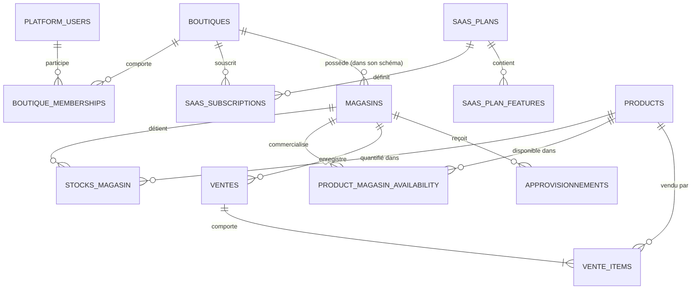

# Section 1 : Architecture & Stratégie Multi-Tenant (PostgreSQL Schema-per-Tenant)

Ce document décrit l'architecture multi-locataire (*multi-tenant*) de TocManager basée sur une isolation stricte au niveau du **schéma PostgreSQL** (`schema-per-tenant`), complétée par un schéma global `public`.

---

## 1. Principes Fondamentaux de l'Architecture

### 1.1 Pourquoi le Schema-per-Tenant ?
- **Isolation Forte des Données** : Chaque boutique cliente dispose de son propre schéma PostgreSQL isolé (ex: `tenant_btq_12345678`). Aucun risque de fuite de données ou de croisement accidentel de tables entre concurrents.
- **Sauvegarde et Restauration Ciblées** : Possibilité d'exporter (`pg_dump -n tenant_xxx`) ou de restaurer les données d'une boutique spécifique sans impacter le reste des marchands.
- **Réglementation et Confidentialité** : Parfaite conformité avec les exigences de protection des données d'entreprises.
- **Évolutivité** : Possibilité future de distribuer des schémas sur différents serveurs de base de données si nécessaire.

---

## 2. Découpage des Schémas PostgreSQL

### 2.1 Schéma Global (`public`)
Le schéma `public` stocke les métadonnées de la plateforme SaaS, partagées par l'ensemble des systèmes :

| Table | Rôle |
| :--- | :--- |
| `platform_users` | Comptes utilisateurs globaux (Super-admins, propriétaires de boutiques, personnel). Contient `id`, `email`, `username`, `hashed_password`, `pin_hash`, `role` (superadmin, merchant, staff). |
| `boutiques` (Tenants) | Annuaire des boutiques/entreprises enregistrées. Contient `id`, `slug`, `name`, `currency`, `country`, `phone`, `logo_url`, `schema_name`, `owner_user_id`, `created_at`, `is_active`. |
| `boutique_user_memberships` | Table de liaison reliant un utilisateur à une ou plusieurs boutiques avec un rôle local (`owner`, `manager`, `cashier`) et la liste des magasins assignés (`assigned_magasin_ids: JSON`). |
| `saas_plans` | Définition des offres (nom, code, prix mensuel, prix annuel, devise, durée d'essai en jours, `is_active`). |
| `saas_plan_features` | Matrice des droits et fonctionnalités activés pour chaque plan (code fonctionnalité, quota numérique optionnel). |
| `saas_subscriptions` | Abonnements actifs des boutiques (liaison `boutique_id`, `plan_id`, statut `trialing`/`active`/`past_due`/`canceled`, `trial_ends_at`, `current_period_end`). |
| `platform_audit_logs` | Traçabilité des actions sensibles du Super-Admin et de la plateforme. |

### 2.2 Schéma Dédié à la Boutique (`tenant_<boutique_id>`)
Chaque boutique possède son propre schéma PostgreSQL contenant ses opérations métiers et son catalogue :

```sql
-- Structure créée dynamiquement pour chaque nouvelle boutique
CREATE SCHEMA tenant_btq_a1b2c3d4;
```

Tables générées dans le schéma de la boutique :
1. `magasins` : Points de vente physiques / succursales rattachés à la boutique.
   - `id (UUID)`, `name`, `code`, `address`, `phone`, `is_active`, `is_warehouse (booléen si réserve/entrepôt)`, `created_at`.
2. `categories` : Catégories de produits de la boutique.
3. `products` : Fiche produit générale (nom, code-barres, unité, catégorie, image, prix de base d'entreprise).
4. `product_magasin_availability` : Disponibilité et paramètres du produit par magasin.
   - `id`, `product_sync_id`, `magasin_id`, `is_available (booléen)`, `custom_price (optionnel)`, `min_stock_alert`.
5. `stocks_magasin` : Suivi strict des stocks par magasin physique.
   - `id`, `magasin_id`, `product_sync_id`, `quantity_on_hand`, `cost_price_average`, `last_updated_at`.
6. `ventes` & `vente_items` : Ventes enregistrées, portant obligatoirement la référence du `magasin_id` où la vente a été effectuée.
7. `approvisionnements` : Entrées en stock rattachées au `magasin_id` destinataire.
8. `stock_transfers` : Mouvements de stock entre magasins de la boutique (`from_magasin_id`, `to_magasin_id`, statut, items).
9. `clients` & `client_payments` : Répertoire client de la boutique et créances.
10. `suppliers` & `supplier_payments` : Fournisseurs et règlements d'approvisionnement.
11. `decaissements` : Dépenses de la boutique, affectées ou non à un magasin spécifique.
12. `tenant_audit_logs` : Journal d'audit propre à la boutique.
13. `tenant_settings` : Réglages internes de la boutique (ticket de caisse, taxes locales, logo).

---

## 3. Gestion Technique Multi-Schéma sous FastAPI & SQLAlchemy

### 3.1 Détermination du Schéma Actif (Tenant Resolution)
Pour chaque requête adressée aux API applicatives (`/api/v1/tenant/...`), le schéma de la boutique est résolu de manière transparente via un middleware FastAPI ou une dépendance d'injection :
1. **Extraction de la Boutique** :
   - Via le header `X-Boutique-Id` ou le claim JWT `current_boutique_id`.
2. **Contrôle d'Habilitation** :
   - Vérification que l'utilisateur authentifié possède bien une adhésion valide (`boutique_user_memberships`) sur cette boutique et que son abonnement SaaS n'est pas suspendu.
3. **Changement Dynamique du `search_path` PostgreSQL** :
   - La session SQLAlchemy exécute :
     ```sql
     SET LOCAL search_path TO tenant_btq_a1b2c3d4, public;
     ```
   - Ainsi, toutes les requêtes ORM standard (`select(Product)`, `select(Vente)`) ciblent automatiquement les tables du schéma de la boutique sans réécrire les modèles.

### 3.2 Provisionnement Automatisé d'un Nouveau Schéma
Lorsqu'un utilisateur finalise l'onboarding de son entreprise/boutique :
1. Insertion des métadonnées dans `public.boutiques`.
2. Exécution du DDL :
   ```sql
   CREATE SCHEMA IF NOT EXISTS tenant_btq_<uuid>;
   ```
3. Application des tables du tenant (via migration Alembic paramétrée ou exécution du template DDL).
4. Création automatique du **Magasin Principal** par défaut (ex: "Magasin Principal / Siège").
5. Création de l'abonnement initial (Plan gratuit ou Période d'essai du plan choisi) dans `public.saas_subscriptions`.

---

## 4. Diagramme Entité-Relation Synthétique


