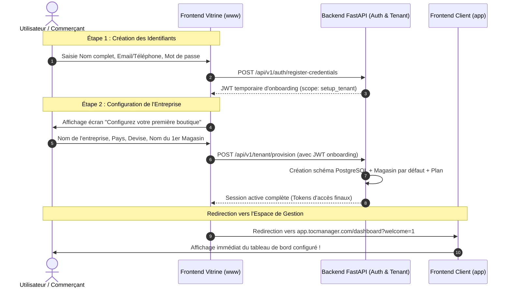

# Section 3 : Landing Page, Page de Pricing & Parcours d'Onboarding Web (`www`)

Ce document spécifie le site public vitrine (`www.tocmanager.com`), la page de tarification interactive et le parcours d'inscription en deux étapes fluides.

---

## 1. Objectifs & Ergonomie de la Vitrine Publique

L'application `www` a pour vocation de convertir les visiteurs en marchands actifs grâce à une présentation claire de la valeur de TocManager, de ses atouts de synchronisation hors-ligne, et de sa modularité multi-magasins.

### 1.1 Pages Principales du Site Public
1. **Accueil (`/`)** :
   - **Hero Section** : Titre accrocheur, sous-titre explicite (*"Gérez vos points de vente, stocks et finances en toute sérénité, en ligne comme hors-ligne"*), capture d'écran animée de l'application et CTA *"Commencer gratuitement"*.
   - **Bénéfices Piliers** : Caisse ultra-rapide, Synchronisation offline native (même sans internet), Multi-magasins & stocks séparés, Gestion des crédits & créances clients.
   - **Démonstration Visuelle** : Carrousels interactifs montrant la vente sur mobile et le pilotage sur grand écran.
   - **Témoignages & Preuve Sociale** : Retours d'expérience de gérants de boutiques et supermarchés locaux.
   - **FAQ & Pied de page** : Réponses aux questions fréquentes (connexion internet, sauvegarde, matériel de caisse).
2. **Tarifs & Forfaits (`/tarifs`)** :
   - Switcher dynamique **Mensuel / Annuel** (avec mention promotionnelle *"2 mois offerts"* sur l'annuel).
   - Cartes comparatives claires pour chaque offre (Plan Gratuit, Plan Pro, Plan Entreprise).
   - Tableau matriciel des fonctionnalités détaillées.
   - CTA renvoyant vers l'inscription avec le plan sélectionné en paramètre d'URL.
3. **À propos & Contact (`/contact`)** :
   - Formulaire de contact pour les besoins personnalisés (grands réseaux de magasins, intégrations matérielles).

---

## 2. Parcours d'Inscription en 2 Étapes (Onboarding Optimisé)

Pour maximiser le taux de conversion, l'inscription est volontairement découpée en **deux phases simples et rapides** :

### 2.1 Étape 1 : Identifiants Simples (`/inscription`)
- **Formulaire épuré** :
  - Nom complet.
  - Email ou numéro de téléphone mobile.
  - Mot de passe (avec jauge de sécurité).
  - Validation des conditions d'utilisation.
- Aucun formulaire complexe, aucune carte bancaire requise.
- Validation instantanée et passage direct à l'étape 2.

### 2.2 Étape 2 : Profil de l'Entreprise & Première Boutique (`/inscription/onboarding`)
- **Informations indispensables pour configurer l'espace de travail** :
  - **Nom commercial de la Boutique / Entreprise** (ex: *"Boutique Élégance Dakar"* ou *"Superette Centrale"*).
  - **Devise de facturation** (FCFA - XOF/XAF, EUR, USD, etc.).
  - **Pays & Numéro de contact commercial**.
  - **Nom du premier point de vente** (pré-rempli par défaut avec *"Magasin Principal"*).
  - **Choix de l'offre de démarrage** :
    - Démarrer avec le **Plan Gratuit**.
    - Ou activer les **14 jours d'essai gratuit du Plan Pro** sans engagement.
- Dès confirmation, le backend instancie le schéma PostgreSQL dédié et redirige le marchand vers son nouveau dashboard sur `app.tocmanager.com`.

---

## 3. Design System & Cohérence Visuelle
- Utilisation des variables partagées Tailwind CSS (palette officielle TocManager : bleu marine professionnel, vert émeraude pour les indicateurs de succès, accents dorés pour les plans Premium).
- Responsive mobile-first soigné pour les gérants s'inscrivant directement depuis leur smartphone.
