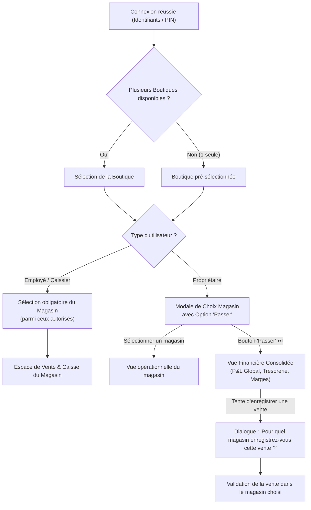

# Section 5 : Espace Client Commerçant & Gestion Multi-Magasins (`app.tocmanager.com`)

Ce document spécifie l'évolution du tableau de bord existant pour en faire le centre de pilotage complet d'une boutique, de ses magasins physiques, de ses stocks dissociés et de son personnel.

---

## 1. Ergonomie Générale : Navigation Multi-Boutiques & Multi-Magasins

### 1.1 Sélecteur de Contexte dans le Header
Le bandeau supérieur (*Header*) intègre deux sélecteurs interconnectés :

```
┌────────────────────────────────────────────────────────────────────────┐
│ 🏪 [ Boutique Élégance Dakar ▼ ]   📍 [ Tous les Magasins (Global) ▼ ] │
└────────────────────────────────────────────────────────────────────────┘
```

1. **Sélecteur de Boutique** :
   - Permet au propriétaire ayant plusieurs commerces de basculer instantanément d'une boutique à l'autre sans se déconnecter.
   - Le switch recharge les données du schéma PostgreSQL correspondant.
2. **Sélecteur de Magasin (Point de Vente)** :
   - Liste les magasins rattachés à la boutique (ex: *Magasin Plateau*, *Magasin Almadies*, *Entrepôt Central*).
   - Option exclusive pour le propriétaire : **"Tous les Magasins (Vue Consolidée)"**.

---

## 2. Parcours Spécifique du Propriétaire à la Connexion

Le flux de connexion est conçu pour s'adapter à la fois au personnel de terrain (qui travaille sur un poste de caisse précis) et au propriétaire (qui supervise l'activité globale) :



### 2.1 Le Bouton "Passer" ⏭️
- Lorsqu'il se connecte, le propriétaire n'est pas contraint de choisir un magasin s'il vient simplement consulter ses indicateurs financiers.
- En cliquant sur **"Passer"**, il atterrit directement sur le tableau de bord consolidé :
  - Chiffre d'affaires agrégé de l'ensemble de ses magasins.
  - Marge brute consolidée et analyse P&L.
  - État global des créances clients et dettes fournisseurs.
- Dès qu'il clique sur une action opérationnelle (ex: *"Nouvelle Vente"*, *"Nouvel Approvisionnement"*), une boîte de dialogue contextuelle lui demande de préciser le magasin concerné.

---

## 3. Gestion Cloisonnée des Produits & Stocks par Magasin

### 3.1 Disponibilité Différenciée
Dans le catalogue de la boutique (`/produits`) :
- Chaque produit possède une fiche descriptive générale (nom, photo, catégorie, code-barres).
- Un onglet **"Disponibilité par Magasin"** permet au gestionnaire d'activer ou désactiver la vente d'un produit magasin par magasin :
  - *Exemple :* L'article "Robe Soirée Or" est activé au *Magasin Plateau* mais désactivé à la *Supérette Banlieue*.
  - Possibilité de définir un **prix de vente spécifique** par magasin (ou d'hériter du prix de base de l'entreprise).

### 3.2 Stocks Indépendants
- Les quantités physiques en rayon et en réserve sont strictement dissociées par magasin :
  - *Magasin Plateau* : 15 unités (seuil d'alerte : 3).
  - *Magasin Almadies* : 0 unité (alerte rupture déclenchée uniquement pour ce magasin).
  - *Entrepôt Central* : 100 unités.

### 3.3 Module de Transfert Inter-Magasins (`/transferts`)
- Permet de transférer facilement des articles d'un magasin source (ex: Entrepôt) vers un magasin cible (ex: Point de vente).
- Workflow en 2 étapes : Émission du bon de transfert ➔ Réception et pointage au magasin destinataire (avec ajustement automatique des stocks respectifs).

---

## 4. Refonte de la Section Utilisateurs & Affectations (`/utilisateurs`)

Dans la section Utilisateurs de l'espace client :
1. **Création / Édition de Collaborateur** :
   - Nom complet, identifiant / email, mot de passe ou code PIN caisse.
   - Rôle : *Gérant de magasin*, *Caissier*, *Magasinier*.
2. **Assignation aux Magasins (Multi-sélection)** :
   - Le propriétaire coche les magasins auxquels le collaborateur est autorisé à accéder :
     - `[✓] Magasin Plateau`
     - `[ ] Magasin Almadies`
     - `[✓] Entrepôt Central`
   - Si un caissier n'est affecté qu'à un seul magasin, ce magasin est sélectionné automatiquement sans invite à chaque connexion.
   - Un caissier ne peut en aucun cas visualiser les chiffres d'affaires des autres magasins auxquels il n'est pas affecté.

---

## 5. Intégration du Feature Gating dans l'Interface Client

- Les boutons et options soumises à un plan supérieur (ex: *"Ajouter un 4ème magasin"*, *"Module Transferts de stock"*, *"Export Grand Livre Comptable"*) disposent d'un badge visuel élégant.
- Le clic déclenche la **Modale d'Upsell** (détaillée en Section 2) permettant de découvrir la valeur de l'option et de mettre à niveau le compte en 1 clic.
