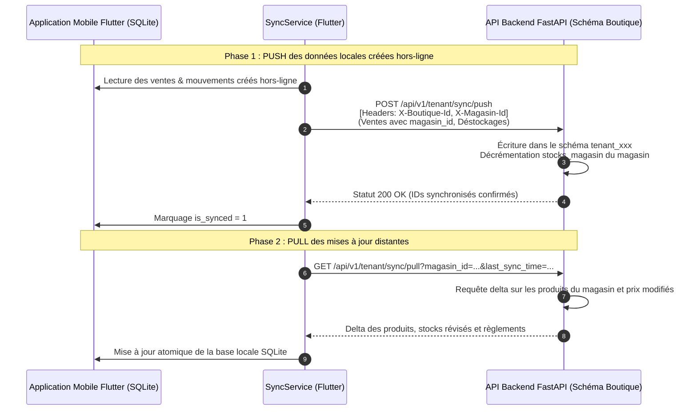

# Section 6 : Application Mobile Flutter & Synchronisation Décentralisée Hors-Ligne

Ce document détaille l'adaptation de l'application mobile Flutter de TocManager pour intégrer la sélection de boutique, l'attribution aux magasins, le mode consolidé du propriétaire et la synchronisation décentralisée offline-first.

---

## 1. Expérience Utilisateur Mobile : Connexion & Sélection du Point de Vente

### 1.1 Écrans de Connexion & Routage
1. **Écran d'Authentification (`login_screen.dart`)** :
   - Saisie de l'identifiant (email ou téléphone) et du mot de passe.
   - En retour, le backend transmet le token JWT et la liste des boutiques/magasins autorisés pour ce profil.
2. **Écran de Sélection de la Boutique (`select_boutique_screen.dart`)** :
   - Si l'utilisateur est rattaché à une seule boutique : franchissement automatique transparent.
   - S'il possède ou travaille pour plusieurs boutiques : présentation d'une liste de cartes élégantes avec logo et nom commercial.
3. **Écran de Sélection du Magasin (`select_magasin_screen.dart`)** :
   - Présentation de la liste des magasins/points de vente attribués au collaborateur.
   - **Pour les caissiers & gérants** : Sélection obligatoire d'un magasin pour charger sa caisse locale.
   - **Pour le propriétaire** :
     - Présence d'un bouton bien en évidence en haut à droite : **« Passer ⏭️ »**.
     - En cliquant sur "Passer", le propriétaire accède directement à l'écran **`consolidated_reports_screen.dart`** (indicateurs financiers consolidés, trésorerie et marges globales).
     - Lorsqu'il bascule sur l'onglet Vente / Caisse, l'application lui propose de sélectionner le magasin sur lequel il souhaite encaisser.

---

## 2. Adaptation de la Base de Données Locale SQLite (`database_helper.dart`)

Pour garantir un fonctionnement hors-ligne fluide et sans ambiguïté sur chaque terminal de caisse :

### 2.1 Évolution du Schéma Local SQLite (Migration v14)
1. **Table `magasins`** (locale) :
   - `id TEXT PRIMARY KEY`, `name TEXT`, `is_active INTEGER`.
2. **Table `products`** (locale) :
   - Les articles stockés localement reflètent le catalogue disponible pour le magasin actif.
   - Colonne `magasin_id TEXT` ajoutée pour lier formellement le produit et son stock à la succursale locale.
   - Stock local `stock REAL` correspondant à la quantité disponible dans ce magasin spécifique.
3. **Table `ventes` & `vente_items`** (locales) :
   - Ajout de la colonne `magasin_id TEXT NOT NULL` sur chaque ticket de vente généré hors-ligne.
4. **Table `approvisionnements` & `decaissements`** (locales) :
   - Rattachement systématique au `magasin_id`.

---

## 3. Moteur de Synchronisation Offline-First (`sync_service.dart`)

Le service de synchronisation client-serveur assure la réplication bidirectionnelle des données entre le terminal mobile et le schéma PostgreSQL de la boutique.

### 3.1 Règles de Synchronisation par Rôle
- **Caissier sur terminal dédié** :
  - La synchronisation locale PULL ne télécharge que les produits actifs et les stocks du magasin assigné. Cela réduit la bande passante et accélère l'initialisation de l'appareil.
- **Propriétaire sur smartphone personnel** :
  - Peut télécharger les synthèses globales ou basculer dynamiquement de magasin (ce qui déclenche une synchronisation ciblée du magasin sélectionné).
