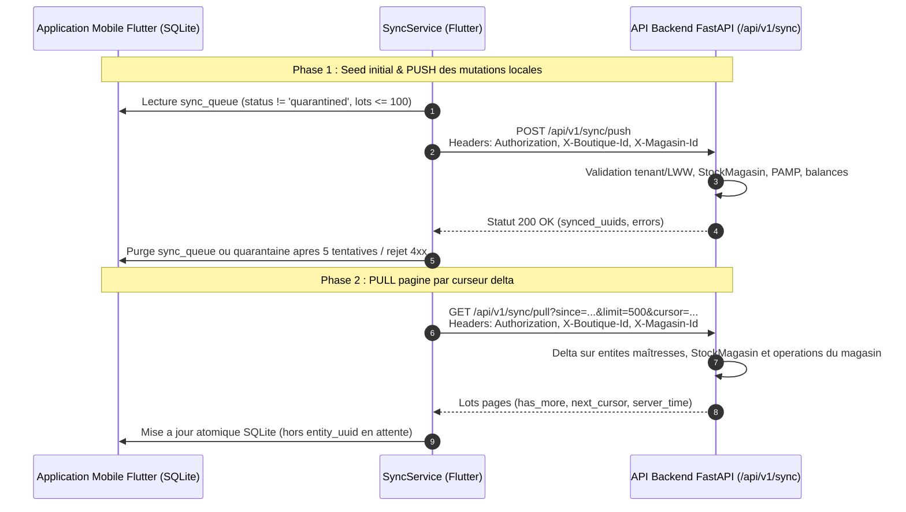

# Section 6 : Application Mobile Flutter & Synchronisation Décentralisée Hors-Ligne

Ce document détaille l'adaptation de l'application mobile Flutter de TocManager pour intégrer la sélection de boutique, l'attribution aux magasins, le mode consolidé du propriétaire et la synchronisation décentralisée offline-first.

---

## 1. Expérience Utilisateur Mobile : Connexion & Sélection du Point de Vente

### 1.1 Écrans de Connexion & Routage
1. **Écran d'Authentification (`login_screen.dart`)** :
   - Saisie de l'identifiant (email ou téléphone) et du mot de passe.
   - En retour, le backend transmet les tokens JWT et la liste des boutiques/magasins autorisés pour ce profil.
2. **Écran de Sélection de la Boutique (`select_boutique_screen.dart`)** :
   - Si l'utilisateur est rattaché à une seule boutique : franchissement automatique transparent.
   - S'il possède ou travaille pour plusieurs boutiques : sélection explicite déclenchant l'isolation et la purge préalable des données métier locales (`TenantSwitchHelper`).
3. **Écran de Sélection du Magasin (`select_magasin_screen.dart`)** :
   - Présentation de la liste des magasins/points de vente attribués au collaborateur.
   - **Pour les caissiers & gérants** : Sélection obligatoire d'un magasin pour charger sa caisse locale.
   - **Pour le propriétaire** :
     - Bouton **« Passer »** donnant accès aux indicateurs financiers consolidés multi-magasins (`consolidated_reports_screen.dart`).
     - Lors d'un passage sur l'onglet Vente / Caisse, sélection obligatoire d'un magasin opérationnel (hors entrepôt pour les ventes).

---

## 2. Adaptation de la Base de Données Locale SQLite (`database_helper.dart`)

Pour garantir un fonctionnement hors-ligne fluide et sans ambiguïté sur chaque terminal de caisse :

### 2.1 Évolution du Schéma Local SQLite (Migrations v14 à v18)
1. **Tables `boutiques` & `magasins`** (locales) :
   - Référentiel tenant mis en cache localement pour permettre la navigation hors-ligne.
2. **Table `products`** (locale) :
   - Colonnes `boutique_id TEXT`, `magasin_id TEXT`, `image_path TEXT`, `is_available INTEGER DEFAULT 1`.
   - `quantity` reflète le stock spécifique au magasin actif (`StockMagasin`), et `price` prend en compte le tarif personnalisé du magasin (`custom_price`) lorsque configuré.
3. **Tables transactionnelles (`ventes`, `vente_items`, `approvisionnements`, `decaissements`, `audit_logs`)** :
   - Rattachement systématique au `boutique_id`, au `magasin_id`, à l'auteur (`user_id`, `user_name`), avec horodatage UTC ISO-8601 (`Z`).
4. **Table `sync_queue`** (v13/v17) :
   - File locale FIFO par lots de 100 opérations, avec colonne `status` (`pending` / `quarantined`) pour isoler les éléments en échec persistant sans bloquer la synchronisation.

---

## 3. Moteur de Synchronisation Offline-First (`sync_service.dart`)

Le service de synchronisation client-serveur assure la réplication bidirectionnelle des données entre le terminal mobile SQLite et PostgreSQL, cloisonnée par les en-têtes HTTP `X-Boutique-Id` et `X-Magasin-Id`.

### 3.1 Règles de Synchronisation par Rôle
- **Caissier / Gérant sur magasin dédié** :
  - `GET /api/v1/sync/pull?since=...&limit=500` retourne les produits enrichis (`stock`, `custom_price`, `is_available`, `magasin_id` du magasin actif) ainsi que les ventes, approvisionnements et décaissements de ce magasin.
- **Propriétaire en mode consolidé** :
  - En l'absence d'en-tête `X-Magasin-Id`, les totaux globaux boutique sont exposés en lecture ; une sélection de magasin reste requise avant toute écriture ambiguë.

### 3.2 Arbitrage des Modules Secondaires hors `/sync`
Les modules transactionnels avancés à fort couplage multi-magasins ou strictement centralisés restent exécutés uniquement via leurs endpoints REST dédiés (online-only) et ne sont pas répliqués dans `/api/v1/sync/*` :
- **Sessions de caisse Z (`/api/v1/cash-sessions`)** : ouverture/clôture et comptage de caisse exigent une validation temps réel côté serveur.
- **Transferts inter-magasins (`/api/v1/transfers`)** : impliquent deux magasins simultanément (source et destination) avec verrouillage atomique serveur.
- **Journal brut des mouvements de stock (`/api/v1/stock-movements`)** : audit comptable en lecture généré côté serveur lors des ventes, réceptions et ajustements.
- **Remboursements détaillés (`/api/v1/ventes/{id}/refund`)** : les annulations et modifications de tickets hors-ligne passent par le payload `VenteSync` standard dans `/api/v1/sync/push`.
