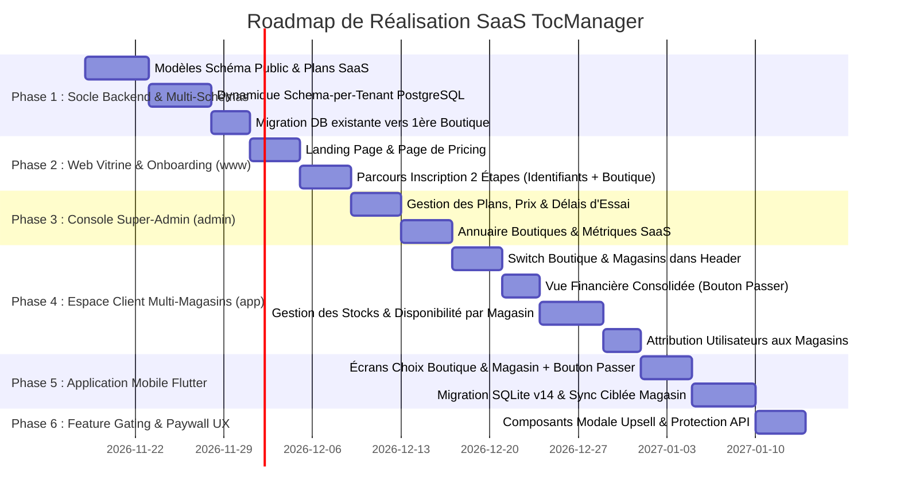

# Section 7 : Roadmap d'Implémentation, Stratégie de Migration & Tests

Ce document définit le séquencement des étapes de réalisation, la stratégie de migration des données existantes et le plan d'assurance qualité exhaustif.

---

## 1. Découpage en Phases Jalonnées

---

## 2. Détail des Phases d'Exécution

### Phase 1 : Socle Backend & Infrastructure PostgreSQL Multi-Tenant
1. Configuration de l'infrastructure PostgreSQL (support des schémas dynamiques).
2. Création des modèles dans le schéma `public` : `platform_users`, `boutiques`, `boutique_user_memberships`, `saas_plans`, `saas_plan_features`, `saas_subscriptions`.
3. Écriture du générateur DDL / Alembic pour provisionner automatiquement le schéma `tenant_btq_<id>`.
4. Script de migration des données actuelles du fichier SQLite `tocmanager.db` vers une première boutique officielle (avec son magasin principal) pour garantir l'absence de perte de données historiques.

### Phase 2 : Vitrine Publique, Pricing & Inscription (`www`)
1. Initialisation du module frontend `www` (React/Vite).
2. Intégration de la Landing page moderne (Hero, sections bénéfices, FAQ, design responsive).
3. Intégration de la page `/tarifs` connectée dynamiquement à l'API des plans du Super-Admin.
4. Flux d'onboarding en deux étapes :
   - Étape 1 : Formulaire d'inscription rapide.
   - Étape 2 : Création de la boutique (nom, devise, pays, premier magasin) et choix de l'offre (Gratuit ou Essai Pro).

### Phase 3 : Console Super-Administrateur (`admin`)
1. Initialisation du module frontend `admin` (React/Vite).
2. Dashboard KPIs SaaS (MRR, ARR, nombre de boutiques, volume global).
3. Interface de paramétrage des forfaits (création/modification, prix, durée des essais gratuits, assignation des features).
4. Table de gestion des boutiques clientes avec actions de suspension, prolongation d'essai et support.

### Phase 4 : Espace Client Commerçant Multi-Magasins (`app`)
1. Mise à jour de l'architecture du dashboard client existant.
2. Ajout des sélecteurs de contexte (Boutique & Magasins) dans la barre de navigation.
3. Implémentation du parcours de connexion pour propriétaire avec le bouton **« Passer ⏭️ »** vers la vue financière consolidée.
4. Écran de gestion des magasins et dissociation des catalogues/stocks par magasin.
5. Adaptation de la gestion des utilisateurs (affectation multi-magasins).

### Phase 5 : Application Mobile Flutter
1. Création des écrans `select_boutique_screen.dart` et `select_magasin_screen.dart`.
2. Ajout de l'accès direct aux rapports consolidés pour le propriétaire (*bouton Passer*).
3. Migration SQLite mobile v14 avec ajout de la clé `magasin_id` sur les tables locales.
4. Adaptation du service `sync_service.dart` pour synchroniser le catalogue et les mouvements du magasin actif.

### Phase 6 : Feature Gating & Paywall Non Bloquant
1. Développement de la modale réutilisable d'upsell (`UpgradePlanModal.tsx`).
2. Interception des clics sur les fonctionnalités restreintes (transferts de stocks, magasins additionnels, exports comptables).
3. Dépendance FastAPI de contrôle de plan sur les routes d'API correspondantes (renvoi d'un code standardisé `403 PLAN_FEATURE_LOCKED` avec payload détaillé).

---

## 3. Stratégie d'Assurance Qualité & Tests

### 3.1 Tests Backend Automatisés (Pytest)
- **Tests d'Isolation Multi-Tenant** :
  - Vérifier qu'une requête exécutée sur le schéma de la Boutique A ne retourne jamais de produit ou vente appartenant à la Boutique B.
- **Tests du Feature Gating** :
  - Vérifier qu'un appel d'API restreint à un forfait Pro échoue avec le statut approprié lorsqu'il est appelé par un compte sur forfait Gratuit.
- **Tests de Période d'Essai** :
  - Simuler l'expiration de la date d'essai et vérifier la transition vers le forfait restreint.

### 3.2 Tests Frontend (Vitest & Testing Library)
- Vérifier le bon affichage de la modale d'upsell lors du clic sur un bouton restreint.
- Tester le switch de boutique et la réinitialisation des caches TanStack Query.
- Tester le formulaire d'onboarding en deux étapes et les validations de champs.

### 3.3 Tests Mobile Flutter
- Tests unitaires sur la migration SQLite v14.
- Tests d'intégration du mécanisme de synchronisation offline-first avec simulation de perte de réseau.
- Validation du parcours utilisateur avec et sans le bouton "Passer" propriétaire.
