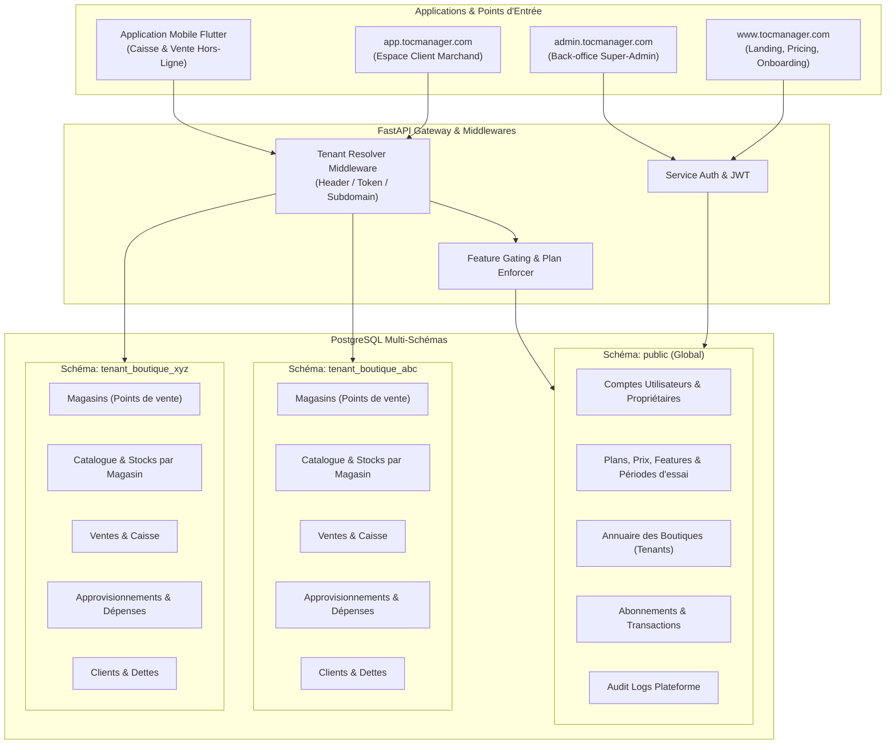

# Plan d'Architecture & Transformation SaaS Multi-Tenant : TocManager

Ce dossier rassemble l'ensemble des spécifications et plans directeurs pour la transformation de **TocManager** en une plateforme SaaS multi-locataire (*multi-tenant*), multi-boutiques et multi-magasins.

---

## 🎯 Vision du Projet

TocManager évolue d'une application monocaisse / mono-entreprise vers un **service SaaS à guichet unique** permettant à n'importe quel commerçant ou entreprise commerciale de créer un compte, définir son entreprise, gérer plusieurs boutiques, et pour chaque boutique administrer un réseau de magasins (points de vente physiques) avec stocks individualisés.

Le projet s'articule autour de **trois piliers d'interfaces web** (sous-domaines distincts dans un monorepo) et d'une **application mobile Flutter** :
1. **`www.tocmanager.com`** : Vitrine marketing, page de pricing interactive, flux d'inscription fluide (identifiants puis onboarding entreprise).
2. **`app.tocmanager.com`** : Espace client / Dashboard commerçant multi-boutiques & multi-magasins, vue financière consolidée, gestion des stocks par point de vente, et incitations de mise à niveau (*paywall non bloquant*).
3. **`admin.tocmanager.com`** : Back-office Super-Administrateur de la plateforme pour piloter les plans, fonctionnalités, périodes d'essai, souscriptions et métriques globales.
4. **Application Mobile (Flutter)** : Caisse et gestion de terrain offline-first avec sélection de boutique et magasin, et mode consolidé financier pour le propriétaire.

---

## 🧭 Plan Orchestrateur : Structure des Fichiers Détaillés

Le plan complet est subdivisé en **7 sections techniques spécialisées** :

| Fichier | Titre | Description sommaire |
| :--- | :--- | :--- |
| [**01_architecture_et_schema_multitenant.md**](./01_architecture_et_schema_multitenant.md) | **Architecture & Schéma Multi-Tenant** | Isolation stricte par schéma PostgreSQL (`schema-per-tenant`), schéma `public` global, modèles de données (Entreprise, Boutique, Magasin, Stocks). |
| [**02_plans_pricing_et_feature_gating.md**](./02_plans_pricing_et_feature_gating.md) | **Plans, Pricing & Feature Gating** | Modèle freemium, plans payants dynamiques, périodes d'essai, moteur de permissions et UX de paywall non bloquant (modale d'upsell interactive). |
| [**03_landing_pricing_et_onboarding_web.md**](./03_landing_pricing_et_onboarding_web.md) | **Landing, Pricing & Onboarding Web** | Interface publique `www` : présentation produit, comparateur de forfaits, inscription en 2 étapes (identifiants -> création entreprise). |
| [**04_backoffice_superadmin.md**](./04_backoffice_superadmin.md) | **Back-office Super-Administrateur** | Interface `admin` : catalogue des plans & tarifs, gestion des accès par plan, suivi des abonnements, annuaire des commerçants et métriques SaaS. |
| [**05_backoffice_client_multimagasin.md**](./05_backoffice_client_multimagasin.md) | **Back-office Client & Multi-Magasins** | Interface `app` : sélecteur/switch de boutique, gestion des magasins, stocks dissociés par magasin, affectation du personnel et vue financière propriétaire. |
| [**06_mobile_flutter_multimagasin_sync.md**](./06_mobile_flutter_multimagasin_sync.md) | **Application Mobile & Sync Décentralisée** | Refonte du login mobile : sélection boutique/magasin, bouton « Passer » propriétaire, moteur de synchronisation SQLite ciblé par magasin. |
| [**07_roadmap_implementation_et_tests.md**](./07_roadmap_implementation_et_tests.md) | **Roadmap d'Exécution & Stratégie de Test** | Découpage en phases jalonnées, scripts de migration PostgreSQL, tests automatisés backend/frontend/mobile et critères de validation. |

---

## 🏛️ Vue d'Ensemble de l'Architecture Système

---

## 🔑 Règles Clés d'Expérience Utilisateur & Métier

1. **Hiérarchie Commerciale** :
   - `Propriétaire` ➔ Gère 1 ou plusieurs `Boutiques` (entreprises).
   - `Boutique` ➔ Possède 1 ou plusieurs `Magasins` (points de vente physiques).
   - `Utilisateurs` (caissiers, gérants) ➔ Affectés à un ou plusieurs magasins d'une boutique donnée.
2. **Stocks et Catalogue Cloisonnés** :
   - Un produit peut être présent dans le magasin A et absent dans le magasin B.
   - Les niveaux de stock sont indépendants par magasin.
3. **Parcours Propriétaire Fluide** :
   - À la connexion, un bouton **« Passer »** permet au propriétaire d'ignorer la sélection d'un magasin précis pour consulter immédiatement la **vue financière consolidée** de sa boutique.
4. **Feature Gating Non Bloquant (Upsell UX)** :
   - Les boutons et fonctionnalités des plans supérieurs restent visibles et cliquables.
   - Lors d'une tentative d'exécution, une modale soignée présente la fonctionnalité et propose une mise à niveau vers le forfait adéquat.
